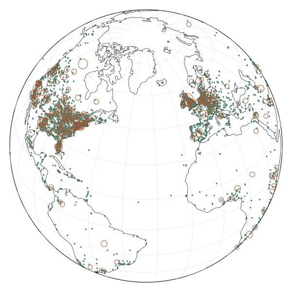

What the Podcast Index datasets could give Elektrolyt
=====================================================

A globe of where shows are made, and what else the index's open files are
good for in the app, ranked by what the listener gains against the work.

Research for Simon, 25 October 2026, measured on the files of 24 October.
The decisions are on the artifact
[Podcast Index Datasets](https://claude.ai/artifact/4cPcJJMV3uV1LbJVkua4Gp),
whose db collection `answers` keeps them.

In short
--------

- **The globe is worth building**, as a Places page that lists shows by
  country and place, with the globe as a view of that list. The data covers
  only 14,799 shows, but nothing else lets a listener find shows by place:
  the Podcast Index API has no location search.
- **The simplest route is to draw an ink globe ourselves** with d3-geo, as
  an inline SVG that Replicant renders. That's about 22 kB of script and
  21 kB of coastlines, with no tiles and no third-party requests, and it
  takes its colours straight from the tokens. The WebGL libraries cost
  275–560 kB and fight the look.
- **The browser can fetch the files directly.** They answer
  `Access-Control-Allow-Origin: *` to any request with an `Origin`. A curl
  without one shows no CORS headers.
- **The next best use is "Recommended by N shows" on the Show page**, a
  reverse podroll from `recommendations.json`. No single feed and no API
  endpoint can give it.
- **Most of the other files are trivia, stale or too big for a browser.**
  Three useful things turned up on the way that need no dataset, among them
  a chart call in podcast-clj that the app has never used.

The datasets
------------

The index publishes fourteen files at
[podcastindex.org/datasets](https://podcastindex.org/datasets). It calls
them "free to mirror and use" and asks that nobody fetch them in tight
loops. There is no named licence. The index refuses curl's default
User-Agent, so the app should send its own name. A credit line on the page
costs nothing, e.g. "Places from the Podcast Index", with a link.

| File | What's in it | Size, updated | For us |
|---|---|---|---|
| `locations.json` | Every live show with a `podcast:location`: the place as written, made in or about, OSM id, country and coordinates | 10.6 MB, 2.1 MB compressed, daily | **The globe** |
| `recommendations.json` | The shows that podrolls name, each with the shows that name it | 23.4 MB, 3.7 MB compressed, daily | **Recommended by** |
| `recommendations_music`, `_video` | The same for music and video | 163 kB, 7.1 MB | Music only to complete the above. 98% of the video links come from three video hubs naming their own channels. |
| `podcastindex_feeds.db.tgz` | The whole catalog as SQLite: title, language, categories, explicit, popularity, guid | 1.83 GB (5.1 GB unpacked), weekly | Not in a browser. It answered questions for this research. |
| `podcastindex_problematic_feeds.csv` | Feeds the index removed, with a reason: spam, AI slop, illegal, duplicate, malicious payload or hijack | 23 MB, daily | Maybe, to flag hijacked feeds in Apple's results |
| `podcastindex_dead_feeds.csv` | The ids of dead feeds, and the id each one duplicates | 30 MB, daily | No: ids only, and the app keys shows by guid |
| `newlyAddedFeeds24hours.csv` | The feeds added in the past day | 1 MB, daily | No: two Danish feeds on the day I looked, and about 30% are spam or gone within a day |
| `valueEnabledFeeds.csv` | Feeds with `podcast:value` | 13 MB, last written 7 Nov 2025 | No: stale, and each feed says it itself |
| `hosting_stats`, `daily_counts`, `hourly_counts` | Totals: shows per host, shows and episodes in the index | 1–117 kB | A line in About at most. Some fields are wrong. |
| `hivenodes.txt` | Hive nodes that passed a health check | 120 B | A small podcast-clj fix, for podping |
| `tracking…/current` | Every new or changed show and episode of the last 200 seconds | 20 MB per window | No: about 8.6 GB a day. Podping covers the listener's own shows. |
| `24hourFeedReport.html` | A daily report for people | – | No |

The globe
---------

### What the data can show

- **Few shows, but lively ones.** 17,023 live shows carry a location, and
  14,799 of them have coordinates we can read. That's 0.3% of the 4.7
  million feeds in the index. They are unusually active, though: 65.7% had
  an episode in the past 90 days, against 9% of the catalog.
- **5,644 distinct points**, most of them in North America and Europe, so
  one side of the globe shows nearly all of them.
- **Many points are a country's centre, not a place.** At least 6,178 of
  the 17,068 points are the centre of a country, region or continent. 916
  shows sit on the centre of the United States, in Kansas. Of the shows on
  points shared by five or more, 8,068 out of 9,108 are hosted by rss.com,
  which seems to let creators pick just a country.
- **Denmark is thin.** Only 38 of the 13,828 Danish-language shows in the
  index have a location. Twelve shows are made within 25 km of Copenhagen.
- **The file says nothing about explicitness or language.** The catalog
  says 19% of the located shows are explicit, but the app can only learn
  which ones from each show's own feed.
- **Every row has a `podcastGuid` and a feed URL**, so each show links
  straight to its page at `/shows/<guid>?url=…`.

### Why not the feeds' IP addresses

The IP addresses of the feeds can't place a show more precisely within its
country. Nearly every show on a coarse point is on a big host behind a
content delivery network: rss.com's feeds resolve to Amazon CloudFront,
Buzzsprout's to Cloudflare, Podigee's to Hetzner in Falkenstein and
Anchor's to Fastly. Those networks answer from the edge nearest to whoever
asks, so looked up from Copenhagen, every Danish show would seem to be in
Copenhagen. A creator who writes only "Denmark" may also mean to say no
more than that, and the app shouldn't work it out behind their back.

### The libraries

| Library | Size, gzip | Picks a point | Keyboard | Fits the look | Requests elsewhere |
|---|---|---|---|---|---|
| **d3-geo** and topojson-client, drawn as SVG | 22 kB + 21 kB coastlines | Ours to write | Ours: buttons | Yes: ink lines, tokens used directly | None |
| cobe | 6 kB | No | No | No: a baked-in dotted map | None |
| MapLibre GL JS 5.24, globe projection | 275 kB (372 kB in its CSP build) | Yes, with clustering | Yes, built in | Partly: colours must be converted from oklch | None, with a style of only GeoJSON |
| MapLibre GL JS 6.15 | 450 kB | Yes | Yes | Partly | None. It finds its worker through `import.meta`, which shadow-cljs's browser build probably breaks. |
| deck.gl GlobeView | 275–299 kB | Yes | Yes | Ours to style | None. The view is experimental. |
| globe.gl, on three.js | 523 kB | Yes | Only modifier and arrow keys | No: three.js takes no CSS colours | None by default |
| CesiumJS | 1.8 MB | Yes | No | No: photographic | Cesium ion, unless reconfigured |

Sizes are gzip -9 of each package's dist files from jsDelivr, checked
against Bundlephobia. shadow-cljs doesn't tree-shake npm code, so the whole
dist counts.

### The recommendation: draw it ourselves with d3-geo

d3-geo's orthographic projection draws the globe as seen from far off: a
sphere that turns, but has no perspective or lighting. Replicant renders it
as an inline SVG, so the view stays a pure function of the places and the
rotation. d3-geo only computes the path strings for the sphere, the
graticule, the coastlines and the places. Those should be memoised on the
rotation, since the page renders once a second during playback. The SVG
takes `var(--ink)` and `var(--paper)` directly, so dark mode and the
Contrast setting follow without code, and the viewBox shrinks to 320 px by
itself.

The list of places is the interface everyone can use. The globe sits in a
`<figure>` with a short label and a caption that points to the list (the
[WAI pattern for complex images](https://www.w3.org/WAI/tutorials/images/complex/)),
and real buttons turn it
([WCAG 2.5.7](https://www.w3.org/TR/WCAG22/#dragging-movements)). Nothing
moves by itself.

MapLibre is the runner-up, for a globe that should one day zoom down to
streets. That needs map tiles, from OpenFreeMap or a Protomaps file on our
own server.

What the d3 route would draw, from the 24 October file: Natural Earth's
coastlines, a 15° graticule, a green dot for each place and a ring for each
point that ten or more shows share, which are mostly country and state
centres. Seen over the Atlantic, 5,221 of the 5,644 points face the viewer.

### The steps

1. **In podcast-clj**, a pure reader that turns a row of `locations.json`
   into the feed model's location map. It puts `geo:` in front of the
   coordinates and reuses `read-geo` and `read-osm` from `feed/coerce`,
   made public, so that the odd forms (`;u=`, an altitude) parse too. The
   47 values that still don't parse, such as "Array", are dropped. It gets
   tests on a fixture of a few rows.
2. **In the worker**, fetch `locations.json` at most once a day, and only
   when Places opens. A new `search.places` groups it: one place per point,
   shows deduplicated by guid (one guid spans two feeds), made in apart
   from about, and an index by country, built once. It's kept in a new
   like-minded cache that Clear cache empties, and STATE.md lists it.
3. **The Places page** at `/places`, as part of Search. Countries are
   folded sections, named by `Intl.DisplayNames`, i.e. the browser's own
   country names, with no word lists. Places sit within them, and their
   show cards have a Show more, since the United States alone has 6,463
   shows. Search gets a "Browse by place" link, and so does a show's "Made
   in" row. Then come the Portfolio scenes and an e2e test. The page can
   ship here, before the globe.
4. **The globe.** Add d3-geo 3.1.1 and topojson-client 3.1.0 to
   package.json, and copy world-atlas's `land-110m.json` (Natural Earth,
   public domain) into `public/`. A `.cljs` namespace computes the path
   strings for a rotation, and the view puts them in the figure.
5. **Turning.** Four buttons turn the globe, and choosing a place in the
   list turns it to that place, with no animation in the first version. A
   country-level point shows as a count on its country rather than as a
   dot.
6. **Later, if wanted:** clicking a dot (a pure nearest-point function,
   plus a Nexus placeholder for a click's SVG coordinates), dragging with
   versor, and an animated turn that respects reduced motion. Canvas only
   if SVG proves slow, which nobody has measured.

Steps 1–3 are an M on the scale below, and the globe on top is an S to M.
podcast-clj gets released once, at the end.

The other candidates
--------------------

Ranked by what the listener gains against the work. S means a few
namespaces and no new page, M a new section or worker job, L new
infrastructure.

### 1. "Recommended by": the reverse podroll

*Effort M–L · recommendations.json, plus the music file · after Places*

A show's page lists the shows whose creators recommend it, e.g.
"Recommended by 49 shows", beside the show's own podroll. It's trust from
other creators, and a way out to shows the listener doesn't know yet.
[Podnews](https://podnews.net/podcasts/recommendations) shows the same on
its pages. The [Podroll Atlas](https://github.com/albertobeta/podroll-atlas)
fetches this very file straight from the browser and keeps it in IndexedDB
for a day.

1. In podcast-clj, a reader that turns rows into maps shaped like
   `show.linked/card`'s, and a reverse index from guid to recommenders.
2. In the app, the worker fetches the file through the same path as
   Places, keeps the index (about 3.6 MB) in a daily cache, and merges in
   the music file, which the all-media one leaves out.
3. A "Recommended by" section after the podroll on the Show page: the
   count, and the first five cards, fetched lazily as the podroll's are.
   Show all for the rest.
4. Apply the Explicit setting once each card's feed is known. Then
   Portfolio scenes and an e2e test.

**Caveats.** 6,837 of the 9,083 recommenders have no title in the file, so
their cards need a feed fetch. 62% of the links come from shows hosted at
Buzzsprout, and networks inflate the counts: one show is recommended by 84
shows, all from its own owner. Only 91 Danish shows are recommended at
all.

### 2. "Often recommended alongside"

*Effort M · recommendations.json · after "Recommended by"*

The shows that creators name together with this one. Hardcore History
leads to In Our Time, The Rest Is History and The History of Rome. Summed
over the listener's subscriptions, it fills a Home shelf of new shows from
their own library, and no profile leaves the browser.

**Caveats.** Only 2,880 of the 24,051 shows get three or more such shows
backed by two recommenders. For a Danish library it's mostly empty.
Merging the podrolls of the shows the listener follows needs no dataset,
so that part can come first.

### 3. "Also about this place"

*Effort S · locations.json · after Places*

A show about Rome leads to the other shows about the same OpenStreetMap
object. It matches on ids, so it works the same in every language.

**Caveats.** Only 310 subject ids are shared by two or more shows (1,712
shows in all). A bare location tag counts as "about" by default, so some
of these really mean "made in".

### 4. Warn about hijacked and spam feeds from Apple

*Effort M · podcastindex_problematic_feeds.csv*

Mark an Apple search result, a pasted URL or an OPML entry that the index
removed as spam, a malicious payload or a hijack, before the listener
subscribes. 117 of 150 sampled flagged iTunes ids still resolve in Apple's
catalog.

**Caveats.** The file is 23 MB and changes daily. Nobody has measured how
often such feeds show up for real queries, so measure that first, by
matching Apple's `collectionId` to the file's `itunesId`.

### 5. A line of index statistics in About

*Effort S · daily_counts.json*

"The Podcast Index lists 4,743,860 shows, and 342,677 had a new episode in
the past 30 days." It credits the index and sets expectations. It's
trivia, though, and several fields in the file are visibly wrong.

Found on the way
----------------

None of these uses a dataset, but the research turned them up.

- **A starting shelf from podcast-clj's `:trending` (S).** podcast-clj
  already calls Apple's chart per country and genre, which needs no
  credentials, and the index's trending by language and category, which
  does. The app has never used either. Apple's Danish chart fills Home for
  a new listener better than a podroll ranking, which has 2 Danish shows
  among the 1,281 most recommended.
- **Follow a gone subscription to its new feed (S–M).** The library marks
  a feed gone after a 410 or 30 failures in a row, and the app says
  nothing. The index's `podcasts/byguid` can find where the guid went. Ask
  the listener before moving, since 24,559 guids are shared by 60,309 live
  feeds. The dead feeds file can't do this, as it holds only ids.
- **Healthy Hive nodes for podping (S, in podcast-clj).** One of podping's
  four built-in nodes, hive-api.arcange.eu, timed out, and it's missing
  from the index's list of seven healthy ones. It matters once the app
  uses podping.

Rejected
--------

- **A "Most recommended" shelf.** It's heavily American, Buzzsprout's
  default podrolls inflate it, and every card needs a feed fetch to filter
  by language. The `:trending` shelf does the job better.
- **"New this week" in the listener's languages.** Two Danish shows were
  added on the day I looked, the file has no episode counts, and about 30%
  of new feeds are spam or gone within a day.
- **A per-language slice of the catalog.** Cutting it from 1.83 GB every
  week on our own server breaks the thin-server rule.
  [Lauschbar](https://github.com/pottrauschen/lauschbar-catalog) has an
  outside job publish such a slice for German. Browsing is covered by
  `:trending`, so its only unique gain would be search on the device.
- **Country badges on search results.** 99.7% of results would have none.
- **"Near me" from the browser's location.** It means a permission prompt
  for twelve shows around Copenhagen. A place the listener picks works as
  well, as
  [Castopod](https://blog.castopod.org/castopod-supports-the-location-tag/)
  argues.
- **The feeds' IP addresses**, for the reasons above.
- **The firehose, the video and music shelves, value-enabled feeds and
  hosting stats**, for the reasons in the table.

Decisions
---------

The recommended option comes first in each.

**The globe**

- **What kind of globe?** An ink globe drawn with d3-geo; or a WebGL
  sphere with MapLibre 5.24; or a flat world map (Equal Earth) instead.
- **How does the app get the files?** The worker fetches them from
  public.podcastindex.org (2.1 MB compressed, nothing on our server); or
  through `/proxy`, so no third party sees the listener, as chapter images
  do.
- **Where does Places live?** At `/places`, as part of Search; or a tab of
  its own; or a section on Home.
- **How should a country-level point read?** As a count on the country,
  and "Somewhere in Denmark" in the list; or as a dot like any other.
- **What about explicit shows?** Fetch each card's feed and follow the
  Explicit setting; or show them all.
- **Ask the Podcast Index to add language and explicit to the files?** Yes,
  with an issue drafted for Simon to open; or no.
- **What does the first globe do?** Turns with buttons and follows the
  list; or also drags, picks a dot and zooms.

**The other candidates** (build after Places, later, or no)

- "Recommended by": after Places.
- "Often recommended alongside": later.
- "Also about this place": later.
- Warnings about hijacked feeds from Apple: later.
- Index statistics in About: no.
- A starting shelf from `:trending`: after Places.
- Following a gone subscription: later.
- Healthy Hive nodes for podping: later.
